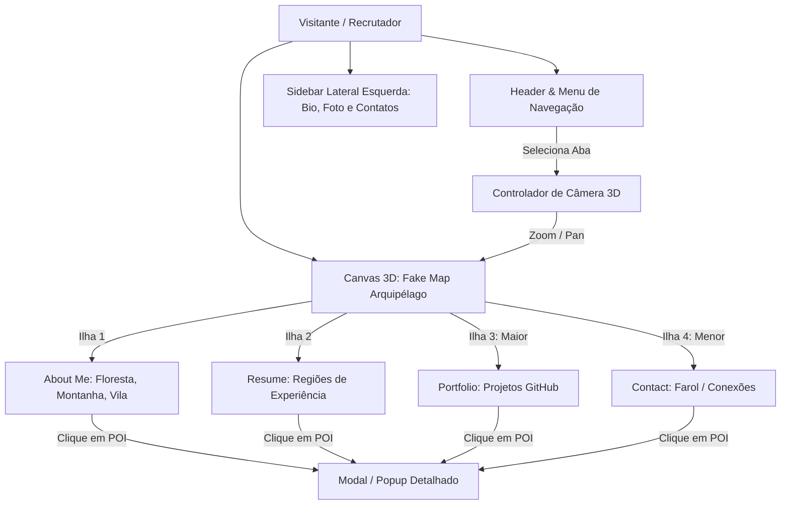
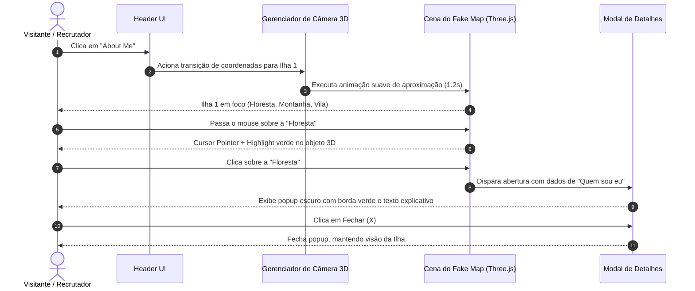
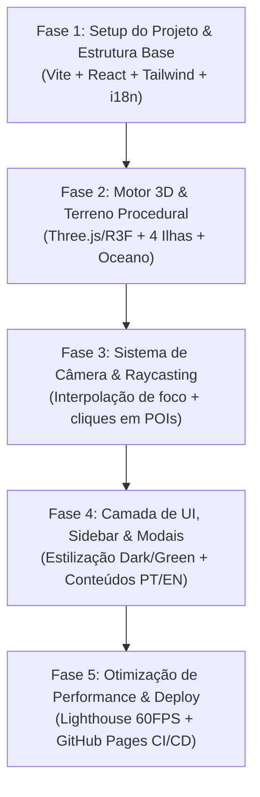

# Product Requirements Document (PRD)
## Portfólio 3D Interativo — Thiago Panchiniak

---

| Metadado | Detalhe |
| :--- | :--- |
| **Projeto** | Portfólio Pessoal 3D Thiago Panchiniak |
| **Autor** | Thiago Panchiniak |
| **Versão** | 1.0.0 |
| **Status** | Aprovado para Desenvolvimento |
| **Target de Deploy** | GitHub Pages (Hospedagem Estática) |
| **Stack Principal** | React, Three.js / React Three Fiber, Tailwind CSS / Styled System, i18next |

---

## 1. Visão Geral e Propósito

O **Portfólio Thiago Panchiniak** é uma aplicação web moderna, imersiva e estática, concebida para apresentar a identidade profissional, trajetória acadêmica, experiências de carreira, habilidades técnicas e projetos em destaque desenvolvidos por Thiago Panchiniak.

A grande diferenciação do produto reside no conceito visual: **uma metáfora cartográfica 3D em um mundo fictício (Fake Map)** desenvolvida puramente com **Three.js**, sem qualquer biblioteca de mapas tradicional (como Leaflet, Mapbox ou OpenLayers). Cada seção do portfólio é materializada como uma ilha temática dentro de um arquipélago fictício, unindo o domínio de **Geoprocessamento (GIS)**, **Engenharia de Dados** e **Inteligência Artificial (IA)** a uma experiência visual lúdica, performática e interativa.



---

## 2. Objetivos de Negócio e Metas do Produto

1. **Apresentação Profissional de Alto Impacto**: Servir como vitrine de competências para recrutadores e gestores de tecnologia e geoprocessamento.
2. **Bilinguismo Nativo**: Disponibilizar alternância de idiomas instantânea entre **Português (PT-BR)** e **Inglês (EN)**.
3. **Demonstração Prática de Competência Técnica**: Provar domínio em gráficos computacionais e visualização espacial (Three.js) sem recorrer a plugins prontos de mapas.
4. **Custo Zero de Infraestrutura**: Construção 100% estática compatível com o **GitHub Pages**, com automação de build e deploy contínuos via GitHub Actions.
5. **Acessibilidade e Desempenho**: Oferecer taxa de atualização constante de 60 FPS, carregamento rápido e legibilidade clara em temas escuros.

---

## 3. Público-Alvo e Personas

### 3.1. Recrutador Técnico (Tech Recruiter / Talent Acquisition)
- **Perfil**: Focado em validar rapidamente senioridade, principais stacks (GIS, Dados, IA) e canais de contato.
- **Necessidade**: Encontrar o currículo, links para LinkedIn/GitHub e resumo de experiências em menos de 10 segundos, sem atritos de usabilidade.
- **Jornada**: Utiliza os botões do cabeçalho ou a sidebar lateral para leitura direta e download do currículo, podendo inspecionar os detalhes via popups.

### 3.2. Líder Técnico / Gestor de Engenharia (Geoprocessamento, Dados e IA)
- **Perfil**: Avalia qualidade de código, arquitetura, criatividade na resolução de problemas e domínio da tecnologia.
- **Necessidade**: Inspecionar os projetos do GitHub na Ilha de Portfólio, verificar o refinamento técnico da cena Three.js e entender as stacks dominadas.
- **Jornada**: Explora a navegação 3D, interage com as regiões do terreno (floresta, vila, montanha), abre os popups descritivos e acessa os repositórios reais no GitHub.

---

## 4. Escopo do Produto

### 4.1. No Escopo (In-Scope)
- **Interface Base**:
  - Paleta de cores dark: **Preto** (`#0a0d12`), **Cinza escuro/médio** (`#161b22`, `#30363d`) e acentos em **Verde** (`#10b981`, `#00ff88`).
  - **Sidebar Lateral Esquerda**: Foto de perfil de Thiago, resumo biográfico conciso, tags de especialidade e links diretos (GitHub, LinkedIn, E-mail).
  - **Cabeçalho Fixo (Header)**: Logo/Nome, botões de navegação (*About Me*, *Resume*, *Portfolio*, *Contact*) e seletor de idioma (*PT-BR* / *EN*).
- **Mundo 3D (The Fake Map)**:
  - Criação de cena com **Three.js** contendo oceano estilizado e 4 ilhas principais interligadas em um arquipélago fictício.
  - Modelagem procedural ou low-poly dos terrenos e elementos de relevo:
    - **Ilha 1 (About Me)**:
      - *Floresta*: "Quem sou eu" (bio aprofundada, visão e postura profissional).
      - *Montanha*: Formação acadêmica e certificações.
      - *Vila*: Interesses e stacks técnicas de atuação (GIS, Engenharia de Dados, Inteligência Artificial).
    - **Ilha 2 (Resume)**: Terreno segmentado em postos/estações cronológicas representando as experiências profissionais.
    - **Ilha 3 (Portfolio - Ilha Maior)**: Terreno de destaque com pontos de interesse que direcionam e detalham projetos práticos e repositórios do GitHub.
    - **Ilha 4 (Contact - Ilha Menor)**: Terreno compacto (estilo farol ou monólito de conexão) focado nos canais de contato e formulário/links rápidos.
- **Navegação & Câmera Cinematográfica**:
  - Movimentação suave de câmera (interpolação esférica/lerp ou tween) para centralizar e dar zoom na ilha correspondente ao clicar nos botões do header.
  - Hover e Raycasting 3D: ao passar o mouse sobre regiões clicáveis, efeito visual (highlight/outline verde) e cursor estilo *pointer*.
  - Ao clicar em uma região/elemento, a câmera ajusta o ângulo e abre um **Modal / Popup** com a informação contextualizada.
- **Internacionalização (i18n)**:
  - Chave de idioma reativa mantendo todo o conteúdo textual traduzido (PT-BR e EN).
- **Deploy**:
  - Pipeline de CI/CD automatizada via GitHub Actions para publicação no GitHub Pages.

### 4.2. Fora do Escopo (Out-of-Scope)
- **Bibliotecas de Mapas JavaScript**: Proibido o uso de Leaflet, Mapbox GL JS, OpenLayers, Cesium, Google Maps API ou decks cartográficos baseados em GIS real. Toda a cartografia é puramente artística/procedural em 3D.
- **Backend Dedicado**: Não haverá servidor Node.js/Python dedicado ou banco de dados relacional. Todo o conteúdo é servido como arquivos estáticos (JSON/YAML/Markdown).
- **Área Administrativa (CMS)**: O gerenciamento de dados de projetos e currículo será feito via arquivos de dados locais versionados no repositório Git.

---

## 5. Arquitetura da Informação & Metáfora Cartográfica 3D

```
+--------------------------------------------------------------------------------------------------+
| HEADER: [ Thiago Panchiniak ]               [About Me]  [Resume]  [Portfolio]  [Contact]   [PT|EN] |
+-----------------------+--------------------------------------------------------------------------+
| SIDEBAR FIXA          | CENÁRIO 3D (THREE.JS FAKE MAP)                                           |
|                       |                                                                          |
| [ Foto de Perfil ]    |         ~ ~ ~ ~ ~ ~ ~ ~ ~ ~ ~ ~ ~ ~ ~ ~ ~ ~ ~ ~ ~ ~ ~ ~ ~ ~ ~ ~ ~ ~ ~    |
| Thiago Panchiniak     |                                                                          |
| GIS | Data | AI       |            [ ILHA 1: ABOUT ME ]               [ ILHA 2: RESUME ]         |
|                       |              (Floresta / Montanha / Vila)       (Postos de Experiência)  |
| "Breve resumo..."     |                                                                          |
|                       |                     [ ILHA 3: PORTFOLIO (MAIOR) ]                        |
| Contatos:             |                         (Vitrines de Projetos GitHub)                    |
| - LinkedIn            |                                                                          |
| - GitHub              |                                            [ ILHA 4: CONTACT ]           |
| - E-mail              |                                               (Farol de Conexão)         |
|                       |         ~ ~ ~ ~ ~ ~ ~ ~ ~ ~ ~ ~ ~ ~ ~ ~ ~ ~ ~ ~ ~ ~ ~ ~ ~ ~ ~ ~ ~ ~ ~    |
| [Download CV]         |  * Clique em um elemento 3D abre Modal Flutuante com detalhes           |
+-----------------------+--------------------------------------------------------------------------+
```

### 5.1. Composição das Ilhas e Pontos de Interesse (POIs)

| Ilha | Proporção Relativa | Elementos 3D (POIs) | Ação ao Clicar / Conteúdo do Modal |
| :--- | :--- | :--- | :--- |
| **1. About Me** | Média | **Floresta Encantada**<br>*(Árvores low-poly estilizadas)* | Abre popup com narrativa pessoal detalhada: quem é Thiago, paixão por tecnologia espacial/dados e filosofia de trabalho. |
| | | **Montanha Esmeralda**<br>*(Picos rochosos com veios verdes)* | Abre popup com a trajetória acadêmica, graduações, especializações e certificados. |
| | | **Vila dos Pioneiros**<br>*(Conjunto de construções geométricas)* | Abre popup com as stacks de atuação categorizadas: Geoprocessamento/GIS, Engenharia de Dados, IA/Machine Learning e Ferramentas. |
| **2. Resume** | Média | **Postos/Marcos da Rota**<br>*(Torres ou monumentos cronológicos)* | Cada marco representa uma passagem profissional (empresa, cargo, período, desafios superados e tecnologias aplicadas). |
| **3. Portfolio** | Grande *(Centro de Destaque)* | **Bases Tecnológicas / Hubs**<br>*(Domos ou plataformas interativas)* | Cada base representa um projeto real do GitHub com screenshot, descrição técnica, tags de tecnologias e botões "Ver Código" e "Demo ao Vivo". |
| **4. Contact** | Pequena | **O Farol / Antena de Sinal**<br>*(Estrutura vertical com feixe de luz)* | Abre modal de contato com e-mail clicável, links sociais (LinkedIn, GitHub) e botão de mensagem rápida. |

---

## 6. Requisitos Funcionais (RF)

| ID | Requisito Funcional | Descrição | Prioridade |
| :--- | :--- | :--- | :--- |
| **RF-01** | **Navegação por Câmera 3D** | Ao clicar em qualquer aba do cabeçalho (*About Me*, *Resume*, *Portfolio*, *Contact*), a câmera do Three.js deve transitar suavemente (zoom + rotação orbital) até a respectiva ilha. | **Must Have** |
| **RF-02** | **Interatividade com Raycaster** | Os elementos da cena 3D (florestas, montanhas, vilas, projetos, etc.) devem emitir reação visual (highlight com tonalidade verde) no hover do mouse e acionar abertura de modal no clique. | **Must Have** |
| **RF-03** | **Modais de Conteúdo Contextual** | Abertura de popups estilizados com backdrop escuro e bordas em verde/cinza, exibindo textos, imagens, tags e botões de ação relacionados ao POI clicado. | **Must Have** |
| **RF-04** | **Sidebar Lateral Fixa** | Exibir foto do Thiago, resumo profissional de apresentação, botões rápidos de redes sociais, e-mail e botão para download do currículo em PDF. | **Must Have** |
| **RF-05** | **Suporte Bilíngue (i18n)** | Alternador de idioma no cabeçalho permitindo alternar instantaneamente entre Português e Inglês, atualizando toda a interface gráfica e os modais 3D. | **Must Have** |
| **RF-06** | **Controles de Câmera e Órbita** | Permitir ao usuário girar levemente a cena (pan/orbit restrito) e dar zoom limitado, sem perder a orientação espacial das ilhas. | **Should Have** |
| **RF-07** | **Modo Visão Geral (Overview)** | Permitir ao usuário retornar à visão panorâmica do arquipélago completo (botão de "Reset Câmera" ou clique no oceano vazio). | **Should Have** |
| **RF-08** | **Links Diretos para Repositórios** | Nos cartões de projetos da ilha Portfolio, disponibilizar hiperlinks funcionais direcionando para as páginas de repositório e deployments do GitHub. | **Must Have** |
| **RF-09** | **Fallback Acessível / Alternativo** | Em telas muito pequenas (mobile) ou dispositivos com WebGL desabilitado, permitir acesso ao conteúdo na íntegra através de gavetas/abas convencionais 2D. | **Should Have** |

---

## 7. Requisitos Não-Funcionais (RNF)

| ID | Categoria | Critério / Especificação |
| :--- | :--- | :--- |
| **RNF-01** | **Performance Gráfica** | A cena 3D deve manter taxa de quadros estável em **60 FPS** em hardwares convencionais (desktops e notebooks com placas integradas). |
| **RNF-02** | **Peso e Carregamento** | O bundle inicial compilado da aplicação deve ser otimizado (Tree-shaking no Three.js, geometrias procedurais ou modelos GLTF low-poly comprimidos), com FCP (*First Contentful Paint*) menor que 2.0s. |
| **RNF-03** | **Compatibilidade Técnica** | Execução garantida nos navegadores modernos que suportam WebGL 2.0 (Google Chrome, Mozilla Firefox, Microsoft Edge, Safari). |
| **RNF-04** | **Paleta de Cores e Estética Dark** | Fundo: `#0a0d12` a `#0f141c`; Superfícies: `#161b22`, `#21262d`; Acentos: `#10b981` (Verde esmeralda), `#00ff88` (Verde neon brilhante); Texto: `#f0f6fc` e `#8b949e`. |
| **RNF-05** | **Hospedagem e Custos** | 100% estático (HTML, CSS, JS), sem necessidade de servidor de aplicação, hospedado gratuitamente no **GitHub Pages**. |
| **RNF-06** | **Sem Bibliotecas de Mapas** | Respeitar estritamente o fora de escopo: nenhuma dependência de Leaflet, Mapbox, OpenLayers, Google Maps ou Cesium. |

---

## 8. Arquitetura Técnica Proposta

### 8.1. Tecnologias Selecionadas

```mermaid
graph LR
    subgraph Frontend [Ecossistema Frontend]
        React[React 18+]
        Three[Three.js / React Three Fiber]
        Drei[@react-three/drei]
        Tailwind[Tailwind CSS]
        I18n[i18next / react-i18next]
        Lucide[Lucide React Icons]
    end

    subgraph Conteudo [Camada de Dados Estáticos]
        DataBio[bio.json]
        DataExp[experiences.json]
        DataProj[projects.json]
        DataSkills[skills.json]
    end

    subgraph Infra [Deploy & CI/CD]
        GHActions[GitHub Actions]
        GHPages[GitHub Pages]
    end

    Conteudo --> React
    Frontend --> GHActions --> GHPages
```

- **Linguagem & Framework**: JavaScript com **React** (Vite como bundler de alta performance).
- **Renderização 3D**: **Three.js** integrado com **@react-three/fiber** (R3F) e **@react-three/drei** para controle declarativo de câmeras, iluminação, shaders e eventos de ponteiro.
- **Estilização**: **Tailwind CSS** com suporte nativo a classes customizadas para a paleta Dark/Green/Gray.
- **Animações e Câmera**: **CameraControls** do `@react-three/drei` ou **GSAP / Tween.js** para transições cinemáticas fluidas entre as ilhas.
- **Internacionalização**: **react-i18next** com suporte a persistência da preferência no `localStorage`.

### 8.2. Estrutura de Diretórios Recomendada

```
ThiagoPanchiniak/
├── .github/
│   └── workflows/
│       └── deploy.yml              # Pipeline de deploy automático no GitHub Pages
├── public/
│   ├── assets/                     # Fotos, ícones, PDF do currículo
│   └── favicon.ico
├── src/
│   ├── components/
│   │   ├── 3d/                     # Componentes Three.js / React Three Fiber
│   │   │   ├── ArchipelagoScene.jsx# Cena principal com iluminação e água estilizada
│   │   │   ├── CameraManager.jsx   # Orquestrador de transição de câmera por rota
│   │   │   ├── IslandAbout.jsx     # Ilha 1: Floresta, Montanha, Vila
│   │   │   ├── IslandResume.jsx    # Ilha 2: Marcos de experiência
│   │   │   ├── IslandPortfolio.jsx # Ilha 3: Vitrines dos projetos
│   │   │   ├── IslandContact.jsx   # Ilha 4: Farol e conexões
│   │   │   └── WaterPlane.jsx      # Shader ou malha de oceano estilizado
│   │   ├── ui/                     # Componentes 2D da Interface
│   │   │   ├── Header.jsx          # Navegação superior e seletor de idioma
│   │   │   ├── Sidebar.jsx         # Resumo, foto, contatos e download de CV
│   │   │   ├── ModalDetail.jsx     # Popups contextuais acionados pelos POIs 3D
│   │   │   └── LanguageToggle.jsx  # Botão de alternância EN / PT-BR
│   ├── data/                       # Arquivos estáticos de conteúdo
│   │   ├── content.en.json         # Textos em Inglês
│   │   ├── content.pt.json         # Textos em Português
│   │   └── islandsConfig.js        # Coordenadas 3D e ângulos de câmera para cada ilha
│   ├── hooks/                      # Hooks customizados (useCameraTransition, etc.)
│   ├── i18n/                       # Configurações do i18next
│   ├── App.jsx                     # Componente raiz que orquestra UI + Canvas 3D
│   └── index.css                   # Configurações globais de estilo e Tailwind
├── index.html
├── package.json
└── vite.config.js
```

---

## 9. Especificação Detalhada da Experiência do Usuário (UX/UI)

### 9.1. Fluxo de Navegação Principal



### 9.2. Estados e Coordenadas de Câmera Propostas

| Visão / Ilha | Posição Alvo da Câmera (X, Y, Z) | Ponto Focal / LookAt (X, Y, Z) | Efeito Sonoro / Visual |
| :--- | :--- | :--- | :--- |
| **Overview (Início)** | `(0, 35, 45)` | `(0, 0, 0)` | Visão panorâmica isométrica suave de todo o arquipélago |
| **Ilha 1: About Me** | `(-15, 12, 18)` | `(-15, 0, 0)` | Aproximação na ilha com destaque para a Floresta, Montanha e Vila |
| **Ilha 2: Resume** | `(15, 12, 18)` | `(15, 0, 0)` | Foco nos marcos cronológicos de carreira |
| **Ilha 3: Portfolio** | `(0, 16, 12)` | `(0, 2, -12)` | Enquadramento da maior ilha com os domos de projetos |
| **Ilha 4: Contact** | `(20, 10, -15)` | `(20, 0, -18)` | Foco suave no farol com feixe de luz rotativo |

---

## 10. Critérios de Sucesso e Métricas de Aceitação

1. **Fluidez e Resposta de Câmera**: A transição de câmera entre as ilhas deve ser suave, sem travamentos de renderização, concluindo entre 1.0s e 1.5s.
2. **Ausência de Bibliotecas de Mapas**: Zero imports de Leaflet, Mapbox, OpenLayers ou equivalentes nos arquivos do projeto.
3. **Internacionalização 100% Funcional**: 100% das labels do Header, Sidebar e textos de Popups devem ser comutados ao alternar entre PT-BR e EN.
4. **Interação Intuitiva com os POIs**: O usuário deve ser capaz de identificar que as regiões são clicáveis graças ao efeito de highlight verde e cursor pointer.
5. **Carregamento Estático no GitHub Pages**: O build estático deve compilar sem erros via comando `npm run build` e ser servido sem quebras de rotas ou de assets no GitHub Pages.

---

## 11. Roadmap de Desenvolvimento e Entregas



- **Fase 1**: Inicialização do repositório React com Vite, configuração do Tailwind CSS com a paleta Preto/Cinza/Verde e infraestrutura de i18n.
- **Fase 2**: Criação do Canvas Three.js/R3F com o oceano estilizado e as geometrias das 4 ilhas temáticas (About Me, Resume, Portfolio, Contact).
- **Fase 3**: Implementação das transições de câmera por estado e detecção de clique/hover nos objetos (Floresta, Montanha, Vila, Projetos).
- **Fase 4**: Integração da Sidebar fixa à esquerda, Header de navegação, modais dinâmicos para cada POI e inserção dos dados de projetos do Thiago.
- **Fase 5**: Ajustes de performance para garantir 60 FPS, responsividade em diferentes telas e pipeline de publicação automática no GitHub Pages.
